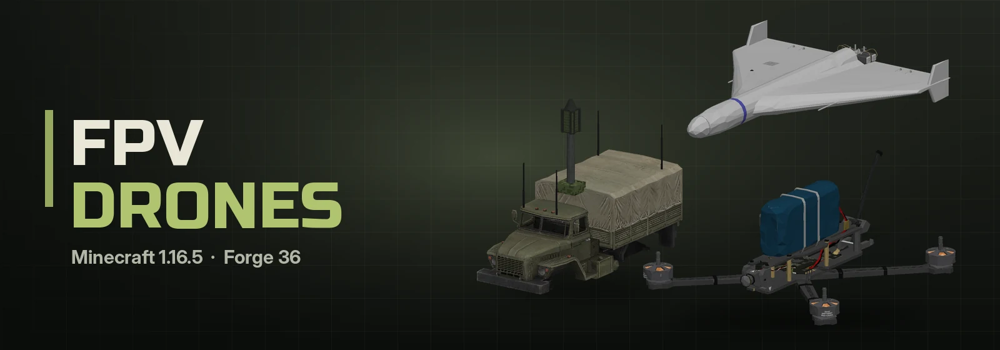
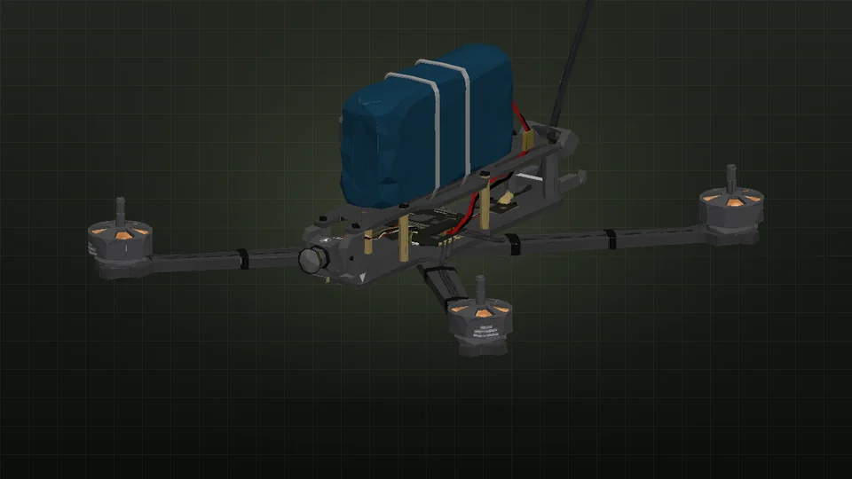
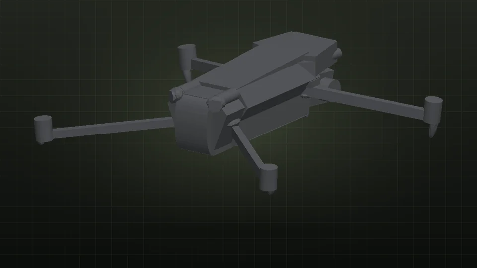
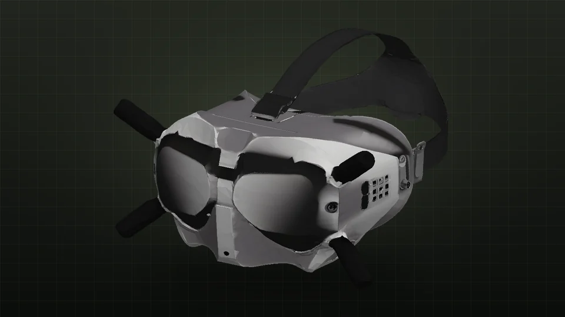
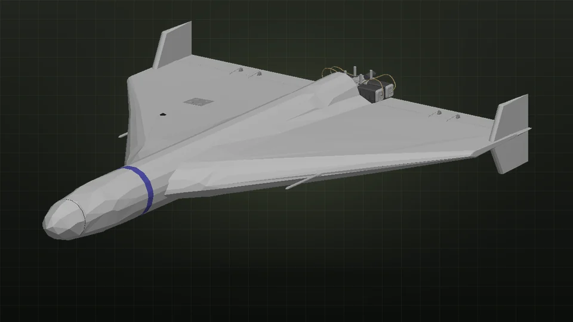
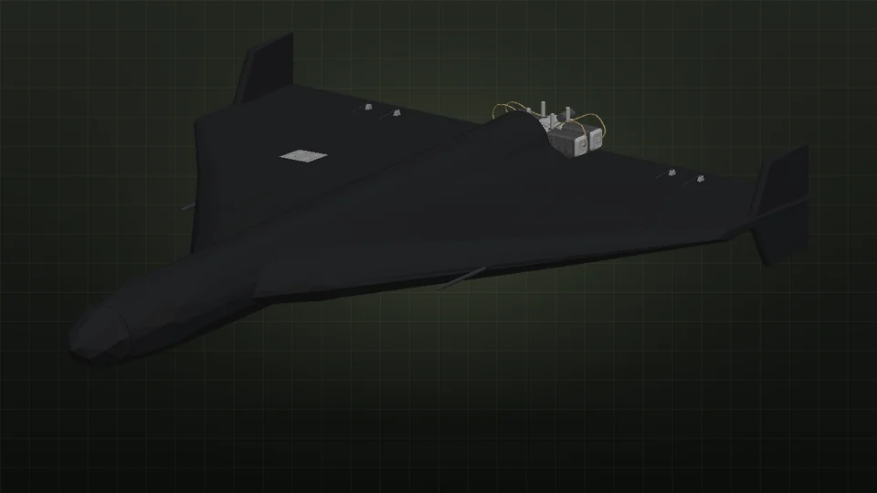
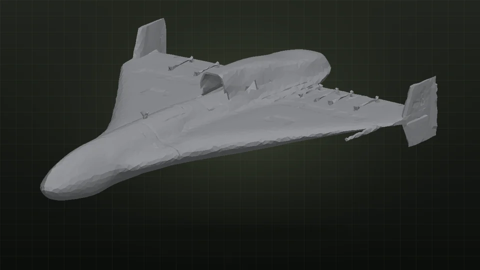
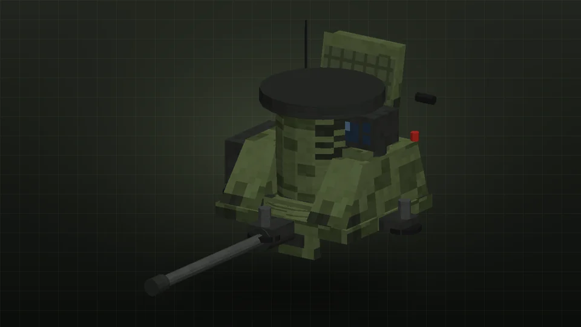
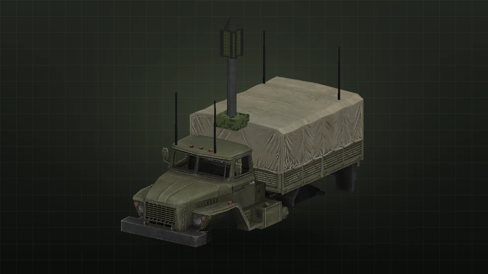

<p align="center"></p>

<p align="center"><b>English</b> | <a href="README.ru.md">Русский</a></p>

<p align="center">
  
  
  
  
  
</p>

<p align="center">
  <a href="https://discord.gg/ycmhfnmCqh"></a>
  <a href="https://t.me/qwarwin4git"></a>
  <a href="mailto:qwarwin@gmail.com"></a>
</p>

FPV drones for Minecraft 1.16.5 on Forge 36: kamikaze quads with real goggles view, a Mavic 3 for recon and drops,
Shahed and Geran strike UAVs with launchers and a launch truck, an anti-drone gun, electronic warfare and the Kornet and
Javelin ATGMs. Built to play with friends, every item is crafted from parts on an assembly bench.

## Gallery

<table>
  <tr>
    <td width="50%" align="center"><br><sub><b>7" FPV kamikaze drone</b></sub></td>
    <td width="50%" align="center"><br><sub><b>Mavic 3</b></sub></td>
  </tr>
  <tr>
    <td width="50%" align="center"><br><sub><b>FPV goggles</b></sub></td>
    <td width="50%" align="center"><br><sub><b>Shahed-136</b></sub></td>
  </tr>
  <tr>
    <td width="50%" align="center"><br><sub><b>Geran-2</b></sub></td>
    <td width="50%" align="center"><br><sub><b>Shahed-238</b></sub></td>
  </tr>
  <tr>
    <td width="50%" align="center"><br><sub><b>ZAK-30 Tsitadel</b></sub></td>
    <td width="50%" align="center"><br><sub><b>EW Ural</b></sub></td>
  </tr>
</table>

## Drones

- **FPV goggles.** A helmet: put it on and you see from the drone your controller is bound to.
- **Drone controller.** Shift+RMB an FPV drone or a Mavic to bind it. RMB with it in hand (goggles on) connects the video.
- **Mavic controller (DJI RC).** Has its own screen, no goggles needed: Shift+RMB a Mavic to bind, RMB to fly.
- **7" FPV drone.** A kamikaze. Hang a PG-7VS, OG-7 or a 5 L bottle under the frame; hitting a block or a mob sets it
  off. With no throttle it falls instead of hovering. Against vehicles (this mod's and Military Tech's) the hit point
  matters: a PG-7VS into the roof, the engine deck or the rear of a tank kills it in two or three hits, the side is
  worse and the front armor barely notices. IFVs, trucks, SAMs and parked aircraft go down in one.
- **Mavic 3.** Recon: holds altitude by itself, zoom up to 28×, shows the coordinates of the point under the
  crosshair. Two hooks for an RGD-5, a VOG-17M or a radio beacon, dropped with **G**.
  - **H** — return to home: climbs 20 blocks above the takeoff point, flies back and lands where it took off (pads
    included). The point the camera was looking at is saved and offered in the launcher menu as "← Mavic point".
  - At 20 % battery it heads home on its own; **H** again cancels. Leaving the camera just leaves it hovering.
  - Swap a flat battery in the field: RMB the drone with a fresh one, the flat one comes back (charge it with redstone
    on the bench).
- **Radio beacon.** Hangs on the Mavic, dropped with **G**. Wherever it lands, or whatever it sticks to (a mob, a
  player, a truck), Shaheds and Gerans home on it: its code goes to chat and fills the launcher menu by itself. The
  beacon travels with what it stuck to and lives 20 minutes.
- **Launch pad.** RMB it with a drone to stand the drone on the stand, the payload hangs between the legs.

## Strike UAVs and launchers

- **Shahed-136, Shahed-238, Geran-2, Geran-5.** The Geran-5 is a jet, almost twice as fast with a heavier warhead.
  The Shahed-238 is a Shahed with a small jet engine instead of the propeller (build it straight away or convert a
  Shahed-136 with an engine).
- **Launcher.** One rail; its menu takes the target (Y can be left out, then it flies along the ground) and a frequency.
- **Launch truck.** A 6×6 KamAZ with a pack for five UAVs and a driver in the cab. RMB to drive, RMB with a UAV to load,
  Shift+RMB for the menu, **G** from the cab. Launch one at a time or all at once: in a salvo every UAV comes in from
  its own direction and altitude, they don't take each other out.
- **Remote launch controller.** RMB a launcher or a truck to bind it (again to unbind). Bind as many as you like, all on
  one frequency; RMB into the air launches from all of them.
- **Operator tablet.** RMB a launcher or a truck to watch its last UAV in flight, Shift+RMB a flying one to bind it.
- **Shahed relay.** An optional mast on a tripod. Without it Shaheds fly as usual; with relays switched on, targets can
  sit further than the normal range: the launcher has to reach a relay, and the target has to be within 12000 blocks
  of it, relays chain up. Under its own relay a Shahed checks its position and EW barely moves it off course.

## Air defense and EW

- **ZAK-30 Tsitadel.** An anti-drone gun: 30 mm cannon, radar and a TV/IR sight on a pedestal, up to 450 blocks,
  10 rounds a second. RMB to take the sight, mouse to aim, **LMB** to fire.
  - The radar sees Shaheds at full range, a quadcopter only from 230 blocks, half that close to the ground, and its
    mark flickers in and out.
  - The fire control computes where the shell meets the target and programs the fuze to burst there in a cloud of
    fragments. The fuze doesn't always work (45 % by default, `airburstReliability`), and fragments often miss a small
    quad. A nimble FPV takes dense fire and lead; Shaheds and aircraft go down much easier.
  - **G** (or Shift+RMB from outside) switches the mode: manual → auto against others (drones, Shaheds, ATGMs; yours
    and your team's are left alone) → auto against **everything in the air** except the owner. In auto it goes for
    missiles first, then Shaheds, then drones. Fed with 30 mm belts (RMB with a belt).
- **EW Ural.** A mobile jammer: a mast with sector antennas over a Ural's bed. RMB to drive, **Shift+RMB** to switch it
  on or off. Jams within 160 blocks.
- **EW tower.** Stationary, 240 blocks, RMB to switch on or off.
- **How EW works.** A hostile FPV or Mavic in the zone gets interference: the picture breaks up, and with a fair chance
  the link drops (an FPV without a link falls). Strongest near the station and far from the pilot, weakest at the edge
  of the zone and close to the pilot. Shaheds lose satellite navigation and miss by 25–95 blocks, losing the beacon
  too; the Geran-2 and Geran-5 with anti-jam antennas drift much less. Your own and your team's drones are left alone.
  Anything can knock out EW, the tower's lattice goes down easiest to a shaped charge or a blast. Radii and chances are
  in the config, section `ew`.

## ATGMs

- **Kornet.** A tripod; RMB to sit. Hold **RMB** for the sight (8×, wheel 3–16×), **LMB** to launch. Beam riding: keep
  the crosshair on the target until it hits. Spare missiles in the inventory load by themselves.
- **Javelin.** Fire and forget. Hold **RMB** for the sight, keep the target in the box for ~2 s until it locks (the
  tone goes high), **LMB** to launch. The missile climbs and hits from above.
- The ATGM warhead is a tandem shaped charge: a blast on the surface, a jet that burns a tunnel up to ~9 blocks (stone,
  concrete, walls; not obsidian or bedrock) and a second blast at its end. A direct Kornet hit kills a Military Tech tank.
- In any sight with zoom (and the Mavic camera) the wheel or `=` `-` zooms, and the mouse slows down with the zoom.

The BMPT Terminator moved to [Military Tech](https://github.com/Qwarwin4/MillitaryTechMod).

## Controls

| | FPV | Mavic |
|---|---|---|
| Mouse | heading and pitch | heading and gimbal |
| W / S | fly where the camera looks | forward / back |
| A / D | sideways | sideways |
| Space / Shift | throttle up / down | up / down |
| Ctrl | boost | sport |
| G | detonate | drop |
| H | | return home |
| Wheel, `=` `-` | | zoom |
| V | leave / connect | leave |

While you're in the camera an "operator" stands in your place. Hit him and the link breaks, the damage goes to you.
The link has a range and walls between you and the drone cut it. Charge the battery with redstone (RMB the drone),
Shift+RMB with an empty hand picks the drone up. **Shift** also leaves the tablet; if you watched it from the truck
cab, you're back at the wheel.

## Crafting

Everything is built on the **assembly bench** (a crafting table with green carpet on top and iron). Electronics need a
**soldering iron** in the tool slot, every solder costs a point of durability. Parts come first: frame, motors,
propellers, ESC, flight controller, receiver, flight stack, battery, FPV camera, antenna, video transmitter, gimbal
camera, GNSS module, display, airframe, piston and small jet engines, warhead, launch booster, the 2A42 30 mm cannon.
Then drones, controllers, goggles, the tablet and the UAVs from them.

All recipes are in [RECIPES.md](RECIPES.md).

## Works with Military Tech

Both mods work alone and together. With [Military Tech](https://github.com/Qwarwin4/MillitaryTechMod) installed:
- its tanks, Grad, Oreshnik and aircraft can be hit by the AA gun, ATGMs and drone drops;
- its aircraft in flight are air targets for the AA gun;
- drones, Shaheds and ATGMs from here are targets for its R-73/R-40.

It's wired through entity tags with optional entries (`data/fpvdrones/tags/entity_types/air_targets.json` and
`shootable.json`), there's no hard dependency.

## Config

`world/serverconfig/fpvdrones-server.toml`: link range, speed, flight time, the power of every munition, fragment
multiplier, strike UAV speed and range, truck speed, ATGM damage, power and penetration (`atgmDamage`, `atgmPower`,
`atgmPenetration`), whether 30 mm shells break blocks, EW radii and chances.

The truck has to be in loaded chunks for the controller to find it (a launcher is loaded by the controller itself).

## Building

JDK 17 (Gradle 7.6 won't start on newer Java).

- **Windows:** double-click `build.bat`. It finds JDK 17, builds the mod and opens the folder with the jar.
- **Linux:** `./build.sh`

The mod is `build/libs/fpvdrones-<version>.jar`, drop it into `mods`.

## Models, textures and sounds

The drones, the Kornet, the truck and the goggles are real 3D models, authors and licenses are in
[MODELS.md](MODELS.md); `tools/gen_meshes.py` prepares them. The other models, textures and sounds come from
`tools/gen_assets.py` (Pillow + numpy, ffmpeg for sounds). Everything is already generated in `src/main/resources`,
the build doesn't need it:

```
python3 tools/gen_assets.py src/main/resources
```

Your own drawings go to `tools/textures/` under the same path as in `assets/fpvdrones/textures/` (for example
`tools/textures/item/drone_remote.png`), the generator uses them instead of its own.

## License

The code is MIT. The 3D models keep their own licenses (CC BY 4.0), see [MODELS.md](MODELS.md).
