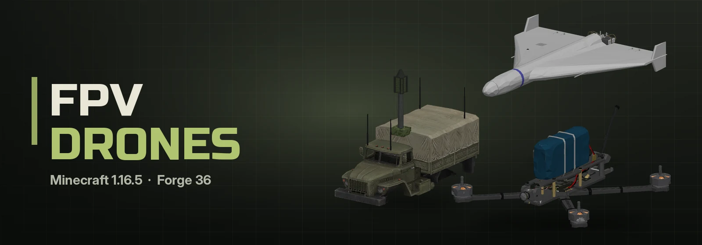
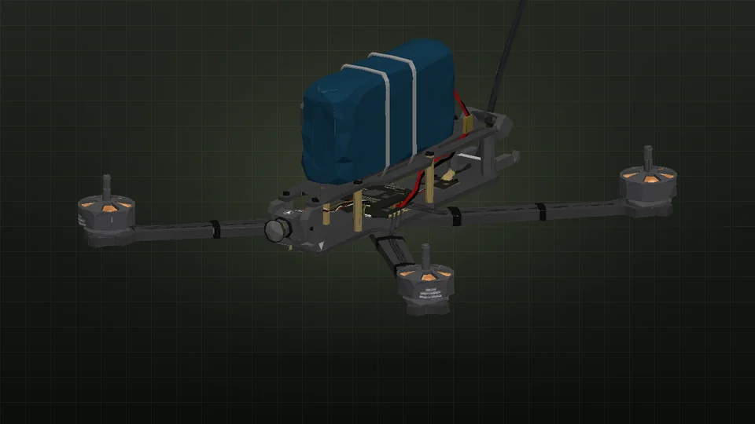
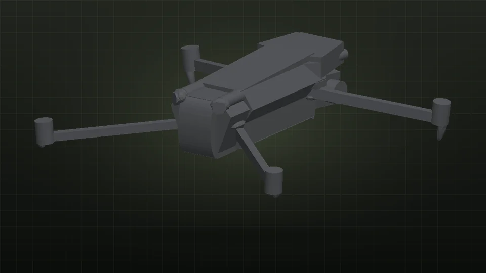
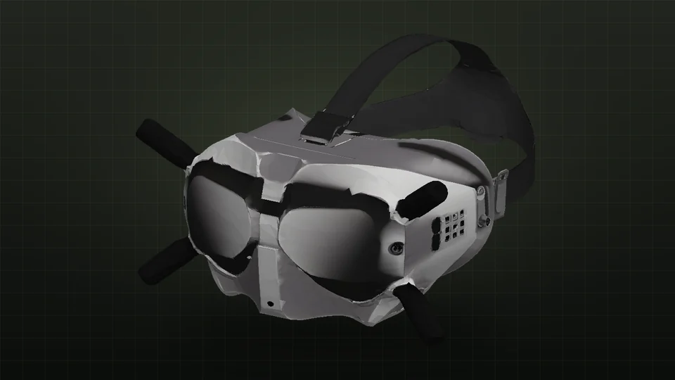
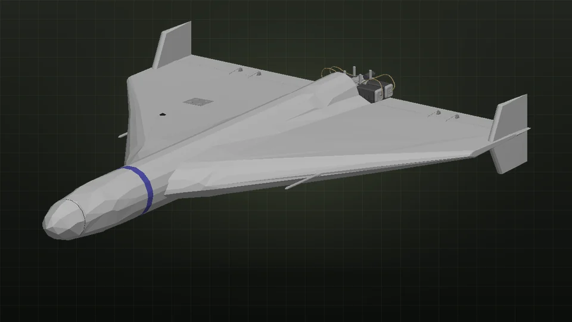
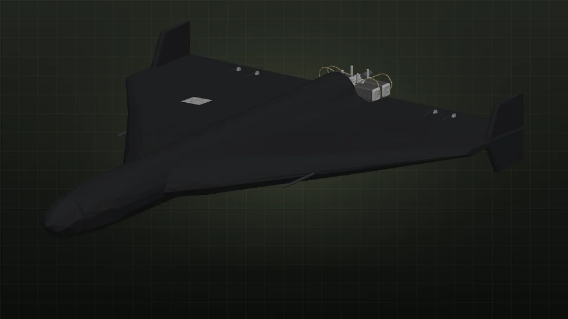
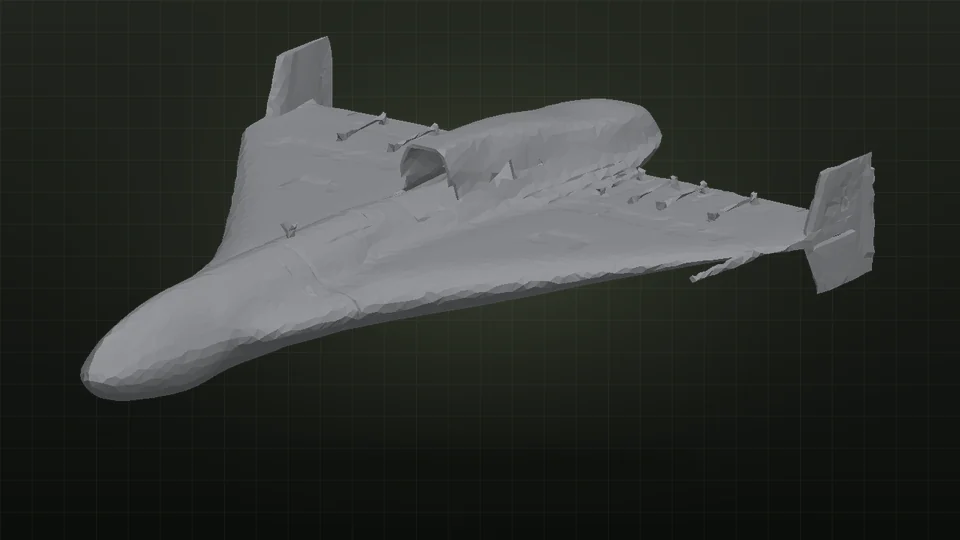
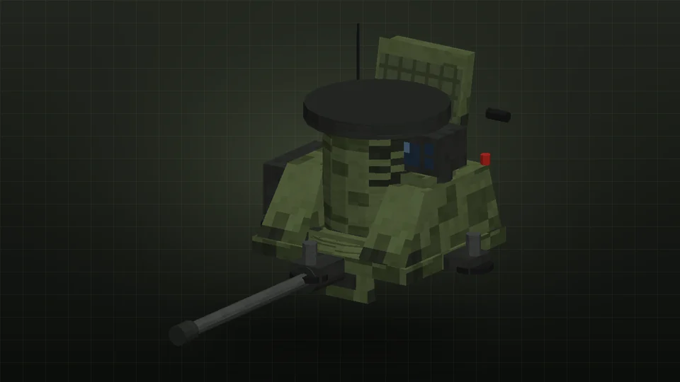
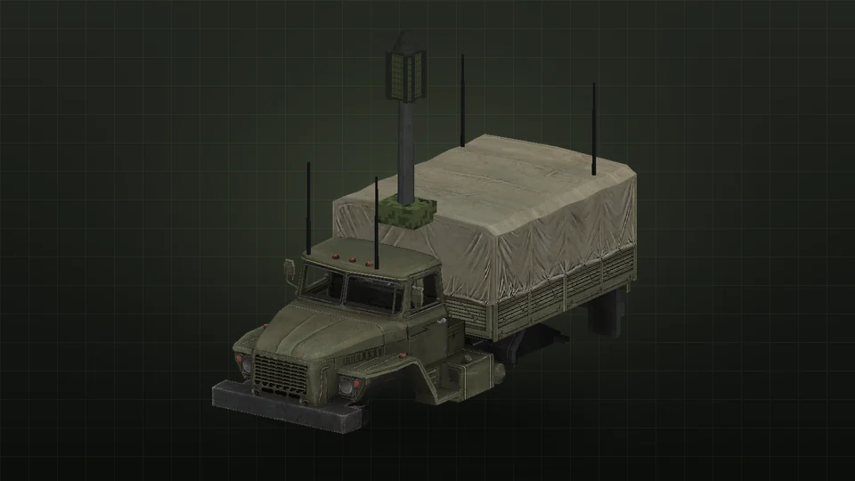

<p align="center"></p>

<p align="center"><a href="README.md">English</a> | <b>Русский</b></p>

<p align="center">
  
  
  
  
  
</p>

<p align="center">
  <a href="https://discord.gg/YOUR_INVITE"></a>
  <a href="https://t.me/qwarwin4git"></a>
  <a href="mailto:qwarwin@gmail.com"></a>
</p>

FPV-дроны для Minecraft 1.16.5 на Forge 36: камикадзе с картинкой в очках, Мавик-3 для разведки и сбросов, Шахеды и
Герани с пусковыми и пусковым КамАЗом, зенитка против дронов, РЭБ и ПТРК «Корнет» и «Javelin». Сделан для игры с
друзьями, всё собирается из запчастей на сборочном верстаке.

## Галерея

<table>
  <tr>
    <td width="50%" align="center"><br><sub><b>FPV-камикадзе 7"</b></sub></td>
    <td width="50%" align="center"><br><sub><b>Мавик-3</b></sub></td>
  </tr>
  <tr>
    <td width="50%" align="center"><br><sub><b>FPV-очки</b></sub></td>
    <td width="50%" align="center"><br><sub><b>Шахед-136</b></sub></td>
  </tr>
  <tr>
    <td width="50%" align="center"><br><sub><b>Герань-2</b></sub></td>
    <td width="50%" align="center"><br><sub><b>Шахед-238</b></sub></td>
  </tr>
  <tr>
    <td width="50%" align="center"><br><sub><b>ЗАК-30 «Цитадель»</b></sub></td>
    <td width="50%" align="center"><br><sub><b>РЭБ на «Урале»</b></sub></td>
  </tr>
</table>

## Дроны

- **ФПВ-очки.** Шлем: надел — и сразу картинка с дрона, к которому привязан пульт в инвентаре.
- **Пульт управления дроном.** Shift+ПКМ по FPV-дрону или Мавику — привязать. ПКМ с пультом в руке (в очках) подключает
  видео.
- **Пульт Мавика (DJI RC).** Со своим экраном, очки не нужны: Shift+ПКМ по Мавику — привязать, ПКМ — лететь.
- **FPV-дрон 7".** Камикадзе. Под раму вешается ПГ-7ВС, ОГ-7 или 5-литровка, удар о блок или моба — подрыв. Без газа не
  висит, а падает. По технике (этого мода и Military Tech) важно, куда попал: ПГ-7ВС в крышу, моторное отделение или
  корму выводит танк за два-три попадания, в борт хуже, лоб почти не берёт. БМП, грузовики, ЗРК и самолёты на земле —
  с одного.
- **Мавик-3.** Разведка: сам держит высоту, зум до 28×, в углу координаты точки под прицелом. Два крюка под РГД-5,
  ВОГ-17М или радиометку, сброс на **G**.
  - **H** — домой: набирает 20 блоков над точкой взлёта, летит назад и садится туда, откуда взлетел (на площадку тоже).
    Точка, куда смотрела камера, сохраняется и подставляется в меню пусковой кнопкой «← точка Мавика».
  - При 20 % заряда улетает домой сам, **H** ещё раз — отмена. Если просто выйти из камеры, он висит на месте.
  - АКБ меняется на ходу: ПКМ по дрону новым, старый возвращается «севшим» (заряжается на верстаке редстоуном).
- **Радиометка.** Вешается на Мавик и сбрасывается на **G**. Куда упадёт или к чему прилипнет (моб, игрок, грузовик),
  туда и наводятся Шахеды и Герани: код метки пишется в чат и сам подставляется в меню пусковой. Метка едет вместе с
  тем, к чему прилипла, и живёт 20 минут.
- **Стартовая площадка.** ПКМ дроном по ней — дрон встаёт на рогатки, подвес висит между ног.

## Ударные БПЛА и пусковые

- **Шахед-136, Шахед-238, Герань-2, Герань-5.** Герань-5 реактивная: почти вдвое быстрее и с более тяжёлой БЧ.
  Шахед-238 — тот же Шахед с малым реактивным двигателем вместо винта (можно собрать сразу или переделать готовый
  Шахед-136 + двигатель).
- **Пусковая установка.** Одна направляющая, в меню цель (Y можно не писать — полетит по земле) и частота.
- **Пусковой грузовик.** КамАЗ 6×6 с пакетом на 5 БПЛА и водителем в кабине. ПКМ — за руль, ПКМ БПЛА — зарядить,
  Shift+ПКМ — меню, из кабины — **G**. Пуск по одному или залпом: в залпе каждый БПЛА заходит со своего направления и
  на своей высоте, друг друга они не сбивают.
- **Пульт удалённого запуска.** ПКМ по установке или грузовику — привязать (повторно — отвязать). Привязывается сколько
  угодно, все на одной частоте; ПКМ в воздух — пуск со всех.
- **Планшет.** ПКМ по установке или грузовику — последний ушедший с неё БПЛА, Shift+ПКМ по летящему — привязка напрямую.
- **Ретранслятор для Шахедов.** Необязательная мачта на треноге. Без неё Шахеды летают как обычно; с включёнными
  ретрансляторами цель можно задавать дальше: пусковая должна доставать до ретранслятора, а цель — быть в 12000 блоков
  от него, ретрансляторы цепляются цепочкой. Под своим ретранслятором Шахед сверяет координаты, и РЭБ почти не сбивает
  его с курса.

## ПВО и РЭБ

- **ЗАК-30 «Цитадель».** Зенитный комплекс против дронов: 30-мм пушка, радар и ТВ/ИК-прицел на тумбе, до 450 блоков,
  10 выстрелов в секунду. ПКМ — сесть за прицел, мышь — наведение, **ЛКМ** — огонь.
  - Радар видит Шахеды на всю дальность, а квадрокоптер — только с 230 блоков, у самой земли вдвое ближе, и отметка то
    появляется, то пропадает.
  - Система управления огнём считает точку встречи и программирует взрыватель на подрыв облаком осколков. Взрыватель
    срабатывает не всегда (по умолчанию 45 %, `airburstReliability`), осколки по маленькому квадрику часто проходят
    мимо. По шустрому FPV нужен плотный огонь с упреждением, Шахеды и самолёты сбиваются заметно легче.
  - **G** (или Shift+ПКМ снаружи) переключает режим: ручной → авто по чужим (дроны, Шахеды, ПТУРы; свои и командные не
    трогает) → авто по **всему в воздухе**, кроме владельца. В авто сначала ракеты, потом Шахеды, потом дроны.
    Заряжается лентами 30 мм (ПКМ лентой).
- **РЭБ на «Урале».** Передвижная станция подавления: мачта с секторными антеннами над кузовом. ПКМ — за руль,
  **Shift+ПКМ** — включить или выключить. Глушит в радиусе 160 блоков.
- **Вышка РЭБ.** Стационарная, 240 блоков, ПКМ — включить или выключить.
- **Как работает РЭБ.** Чужой FPV или Мавик в зоне ловит помехи: картинка сыпется, и с умеренной вероятностью связь
  рвётся совсем (FPV без связи падает). Сильнее всего у станции и когда дрон далеко от пилота, слабее на краю зоны и
  рядом с пилотом. Шахедам РЭБ сбивает спутниковую навигацию: такой Шахед уходит мимо цели на 25–95 блоков и теряет
  радиометку; Герань-2 и Герань-5 с антиджемминговыми антеннами сбиваются заметно реже. Свои и командные дроны станция
  не трогает. Сбить РЭБ можно чем угодно, решётку вышки проще всего взять кумулятивом или взрывом. Радиусы и шансы — в
  конфиге, раздел `ew`.

## ПТРК

- **«Корнет».** Тренога, ПКМ — сесть. Зажми **ПКМ** — прицел (8×, колесом 3–16×), **ЛКМ** — пуск. Ракета идёт по лучу:
  держи перекрестье на цели до попадания. Запасные ракеты из инвентаря заряжаются сами.
- **«Javelin».** «Выстрелил и забыл». Зажми **ПКМ** — прицел, держи цель в рамке ~2 с до захвата (тон станет высоким),
  **ЛКМ** — пуск. Ракета уходит горкой и бьёт сверху.
- БЧ ПТУР — тандемная кумулятивная: взрыв на поверхности, струя прожигает тоннель до ~9 блоков (камень, бетон, стены;
  обсидиан и бедрок не берёт) и второй взрыв в конце. Прямое попадание «Корнета» убивает танк из Military Tech.
- В любом прицеле с зумом (и в камере Мавика) колесо или `=` `-` — зум, мышь замедляется пропорционально увеличению.

БМПТ «Терминатор» переехал в [Military Tech](https://github.com/Qwarwin4/MillitaryTechMod).

## Управление

| | FPV | Мавик |
|---|---|---|
| Мышь | курс и наклон | курс и подвес камеры |
| W / S | лететь туда, куда смотрит камера | вперёд / назад |
| A / D | вбок | вбок |
| Пробел / Shift | газ вверх / вниз | вверх / вниз |
| Ctrl | форсаж | спорт |
| G | подрыв | сброс |
| H | | домой |
| Колесо, `=` `-` | | зум |
| V | выйти / подключиться | выйти |

Пока смотришь в камеру, на твоём месте стоит «оператор». Ударят его — связь рвётся, а урон прилетает тебе. Связь
ограничена дальностью, стены между тобой и дроном её режут. Батарея заряжается редстоуном (ПКМ по дрону), Shift+ПКМ
пустой рукой — забрать дрон. Из планшета можно выйти и на **Shift**; если смотрел в него из кабины грузовика, окажешься
обратно за рулём.

## Сборка в игре

Всё собирается на **сборочном верстаке** (верстак + зелёный ковёр сверху + железо). Электронику без **паяльника** в
слоте инструмента не собрать, каждая пайка тратит единицу прочности. Сначала запчасти: рама, моторы, пропеллеры,
регулятор, полётный контроллер, приёмник, полётный стек, АКБ, FPV-камера, антенна, видеопередатчик, камера на подвесе,
модуль ГНСС, дисплей, планер, поршневой и малый реактивный двигатели, боевая часть, стартовый ускоритель, 30-мм пушка
2А42. Потом из них дроны, пульты, очки, планшет и БПЛА.

Все рецепты — в [RECIPES.md](RECIPES.md).

## Вместе с Military Tech

Моды работают и по отдельности, и вместе. Если стоит [Military Tech](https://github.com/Qwarwin4/MillitaryTechMod):
- его танки, «Град», «Орешник» и самолёты поражаются зениткой, ПТУРами и сбросами с дронов;
- его самолёты в воздухе зенитка видит как воздушные цели;
- дроны, Шахеды и ПТУРы отсюда — цели для его Р-73/Р-40.

Связка сделана через теги сущностей с необязательными записями (`data/fpvdrones/tags/entity_types/air_targets.json` и
`shootable.json`), жёсткой зависимости нет.

## Конфиг

`world/serverconfig/fpvdrones-server.toml`: дальность связи, скорость, время полёта, мощность всех боеприпасов,
множитель осколков, скорость и дальность ударных БПЛА, скорость грузовика, урон, мощность и пробитие ПТУР
(`atgmDamage`, `atgmPower`, `atgmPenetration`), ломают ли 30-мм снаряды блоки, радиусы и шансы РЭБ.

Грузовик должен быть в прогруженных чанках, чтобы пульт его нашёл (установку пульт прогружает сам).

## Сборка

Нужен JDK 17 (на более новой Java Gradle 7.6 не запустится).

- **Windows:** дважды кликни `build.bat`. Он сам найдёт JDK 17, соберёт мод и откроет папку с готовым jar.
- **Linux:** `./build.sh`

Готовый мод — `build/libs/fpvdrones-<версия>.jar`, его кладёшь в `mods`.

## Модели, текстуры и звуки

Дроны, «Корнет», грузовик и очки — настоящие 3D-модели, авторы и лицензии в [MODELS.md](MODELS.md), их готовит
`tools/gen_meshes.py`. Остальные модели, текстуры и звуки генерирует `tools/gen_assets.py` (Pillow + numpy, для звуков
ещё ffmpeg). Для сборки мода он не нужен — всё уже лежит в `src/main/resources`:

```
python3 tools/gen_assets.py src/main/resources
```

Свои рисунки кладутся в `tools/textures/` с тем же путём, что в `assets/fpvdrones/textures/` (например
`tools/textures/item/drone_remote.png`): генератор подменит ими сгенерированные.

## Лицензия

Код — MIT. У 3D-моделей свои лицензии (CC BY 4.0), см. [MODELS.md](MODELS.md).
